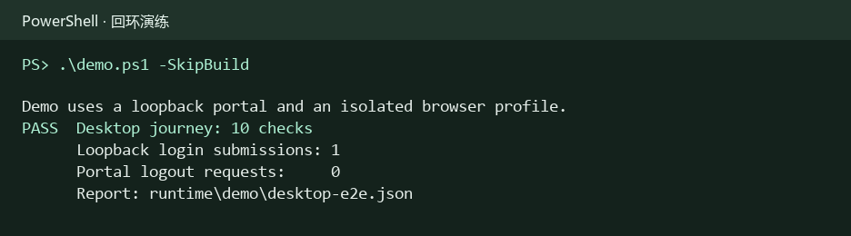

# SUSE 校园网守护

一个 Windows 校园网自动登录工具。电脑留在学校，人不在旁边，也不用专门跑一趟去联网。

[下载 Windows x64 便携包](https://github.com/WHaoxM/campus-network-guardian/releases/latest) · [安装和使用](#安装和使用) · [先试演练](#先试演练)

## 使用场景

- 电脑放在实验室、寝室或教室，人在别处，想用手边的设备远程连回去接着做科研、跑程序。
- 第二天早上想接着干活，不想为了开机后登一下校园网，再专门跑一趟学校。

校园网晚上到点会断。第二天电脑如果没重新联网，你在外面就远程连不上。另买路由器，或者用需要付流量费的随身 Wi‑Fi，又是一笔开支。

只要电脑已经开机、也配好了远程工具，早上就不用特地跑去联网。守护器会在开放时段这样处理：

- **没连 Wi‑Fi，也没有外网**：先连接 Windows 里已保存的 SUSE；连上后还是没网，就自动登录校园网。
- **已经连着 SUSE，但外网掉了**：确认断网后再尝试恢复。外网正常就不重新登录。
- **连着其他 Wi‑Fi**：即使那个 Wi‑Fi 上不了网，也不会抢占或切到 SUSE。

不在开放时段时，守护器不会主动连 Wi‑Fi、登录或下线。[查看默认时段](docs/INSTALL.md#3-日常使用)。

## 适用范围

目前只适配**四川轻化工大学的 SUSE 校园网**，其他学校暂不支持。最初是写给自己用的，用下来还行，就开源出来，给有同样需求的校内同学用。

这不是校方客户端，也不负责给关机的电脑开机、配置远程桌面或延长校园网开放时间。


<sub>实际桌面窗口的隔离演练：Wi‑Fi 状态和校园网门户均为模拟，不会改变当前网络。</sub>

## 安装和使用

**1. 安装一次，以后每天自动联网**

按 [安装说明](docs/INSTALL.md) 安装 Python，然后在解压目录运行一次：

```powershell
powershell.exe -NoProfile -ExecutionPolicy Bypass -File .\setup.ps1
```

第一次用 Windows 手动连上 **SUSE**，让系统记住这个 Wi‑Fi；之后不用每天手动连。接着双击 **open_guardian.cmd**。填校园网账号和密码，点 **保存并开启守护**，允许 Windows 权限提示。程序会安装开机任务，不用每天跑命令，也不用自己改配置文件。备用账号不是必填，以后想加，从右上角打开「账号管理」就行。

**2. 平时只待在托盘，不挡屏幕**

登录 Windows 后，只在系统托盘显示图标，不弹窗；点开才加载桌面界面。想看状态、筛日志或暂停自动恢复时再打开。点右上角 **×** 收回托盘，后台继续守护。

## 先试演练

解压便携包后，在该目录用普通用户 PowerShell 运行：

```powershell
.\setup.ps1
.\demo.ps1 -SkipBuild
```

从源码运行时，安装 [.NET 10 SDK](https://dotnet.microsoft.com/en-us/download/dotnet/10.0)，将第二条命令改为 `.\demo.ps1`。两种方式都需要 Windows x64、Python 3.11+、Microsoft Edge 和 WebView2 Runtime。首次准备会下载依赖；之后的演练使用本机回环端点，不会安装计划任务、改 Wi-Fi 或访问真实校园门户，也不需要填账号。



查看静态截图：[状态](docs/media/status.png) · [日志](docs/media/logs.png) · [暂停](docs/media/paused.png)

## 开发

Python 守护器和 WinForms/WebView2 界面分别运行。账号在本机保存；状态页和日志不显示完整账号或密码。暂停由守护器执行并确认。详见 [开发与验收](docs/DEVELOPMENT.md) · [安全报告](SECURITY.md) · [MIT 许可证](LICENSE)。
