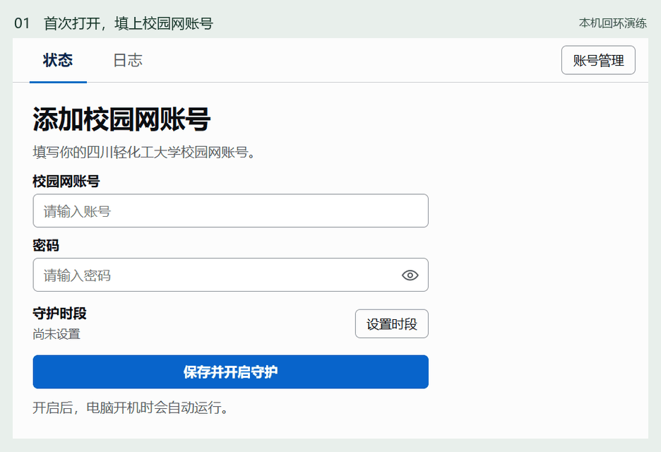

# SUSE 校园网守护

电脑留在实验室、寝室或教室，不用每天跑回去登录校园网。它在开放时段自动接入或恢复 SUSE，让已经开机、配好远程工具的电脑重新可达。

**目前只适配四川轻化工大学 SUSE 校园网。** 原本是自己在用，开源给有同样需求的同学。

## 开始使用

1. [下载 Windows x64 便携包](https://github.com/WHaoxM/campus-network-guardian/releases/latest)并完整解压。准备好 64 位 Python（建议 3.13，安装时勾选 **Add Python to PATH**）、Edge 和 WebView2 Runtime。
2. 用 Windows 手动连一次 **SUSE**，让系统记住它。双击 **`suse.cmd`**（也可在 PowerShell 运行 `.\suse.cmd`）。首次会安装项目依赖，需要联网。
3. 填校园网账号和密码，点 **保存并开启守护**，允许 Windows 权限提示。以后不用每天跑命令；要看状态、日志或改账号，从托盘打开。

没连 Wi‑Fi、也没有外网时，守护器先连接已保存的 SUSE，再按需登录。**连着其他 Wi‑Fi 不抢占，已经联网不重登，到点也不主动下线。**

实际窗口演示，Wi‑Fi 和门户使用模拟数据。

[安装与旧版说明](docs/INSTALL.md) · [开发文档](docs/DEVELOPMENT.md) · [安全报告](SECURITY.md) · [MIT 许可证](LICENSE)
