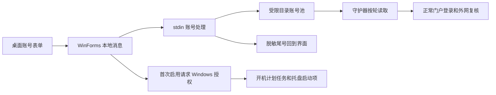

# 开发与验收

| 位置 | 职责 |
| --- | --- |
| `suse.cmd` | 用户入口；源码与发行包都调用 `app/scripts/suse.ps1` |
| `app/desktop/` | WinForms 窗口、托盘、单实例和本地 WebView2 资源 |
| `app/campus_maintenance.py` | 时段、网络判定、Wi-Fi 门禁与恢复 |
| `app/campus_schedule.py` | 周时段校验、旧配置读取和自定义设置持久化 |
| `app/campus_status.py` / `app/campus_log.py` | 脱敏状态、轮转日志和暂停确认 |
| `app/campus_accounts.py` / `app/desktop/AccountService.cs` | 仅本地设置账号、显示尾号、衔接启动任务 |
| `app/enable_guardian.ps1` | 通过 Windows 授权安装并启动同一用户的 S4U 任务 |
| `app/browser_login.py` | 隔离 Edge 上的正常门户登录与外网复核 |
| `app/network_diagnostics.ps1` | 认证遇到网络错误后的限时只读 DNS 对照，只回传结果布尔值 |
| `scripts/` | 开发者构建、打包和演练；不跟便携包发 |
| `tests/` | 仅回环门户和部署产物的端到端演练 |

守护器按现有 Wi-Fi 和外网状态决定是否恢复。桌面账号表单通过 WebView2 的本地消息和子进程 stdin 保存，列表只回传尾号。首次设置调用 Windows 授权；任务确认启动后才安装托盘启动项，不要求先完成校园网认证。暂停仍由守护器执行并确认。



账号文件以明文保存在当前 Windows 用户、SYSTEM 和管理员可访问的受限目录，以便同一用户的 S4U 任务读取；禁止提交、上传或把运行目录打包。密码不经命令行参数、日志或状态快照。守护器每轮读取最新账号，提交前还检查该账号未被修改或删除。

守护时段沿用已有 WebView2 本地消息和受限目录（与状态快照同目录的 `schedule.json`）。桌面校验后落盘；后台每轮读取，在 Wi-Fi 或认证动作前复核，心跳回传已读取的时段版本。新安装没有默认时段；仅无自定义文件时读取本机旧版 TOML 的 `schedule.windows`，自定义文件无效时仅观测，不回退到旧时段。周时段界面参考 [Cal.com](https://mobbin.com/screens/599f0196-e1bc-4fde-8706-0c49b3856755) 和 [HoneyBook](https://mobbin.com/screens/de3164f7-d829-403c-bd7c-00f064bef12b) 的星期开关与并排时间栏，未复用代码或图片。

从仓库根目录运行下列命令；构建需要 [.NET 10 SDK](https://dotnet.microsoft.com/en-us/download/dotnet/10.0)。源码运行环境与桌面产物在 `app/`，SDK 缓存、测试报告和候选 ZIP 在根目录的 `runtime/`，均不提交。

```powershell
.\app\setup.ps1
.\scripts\build_desktop.ps1
.\scripts\demo.ps1 -SkipBuild
```

演练使用真实 EXE、WebView2 和本机回环门户，不触碰原有校园网。短流程覆盖首次选择守护时段、跨日及重叠校验、在线修改时段并停止待提交的登录，以及账号管理、恢复、日志与暂停。测试模式不会登记真实 Windows 任务；S4U 和实际门户需在部署机单独验收。要验证保留的旧时段与账号轮换，可单独运行：

```powershell
.\app\.venv\Scripts\python.exe -X utf8 tests/e2e_campus_maintenance.py --config app/config/campus.toml --portal tests/data/browser_journey.json --html tests/data/browser_portal.html --journey tests/data/campus_journey.json --output runtime/guardian-e2e.json
```

`scripts/demo.ps1` 默认演示可见的短流程。要额外验证暂停到期与守护重启：

```powershell
.\app\.venv\Scripts\python.exe -X utf8 tests/e2e_desktop.py --exe app/runtime/desktop/CampusGuardian.exe --output runtime/desktop-e2e
```

打包前先提交公开源码、重新构建，再运行 `python scripts/package.py --version 0.2.3`。ZIP 按运行文件清单生成，第三方许可在 `app/licenses/`。测试、演练与开发脚本只留源码，不随包发；发布方应从实际解压包验证入口，而不是让下载者跑测试。仅验收当前布局时，可附 `--output-dir runtime/layout-verification`，不覆盖现有发行文件。

```powershell
.\app\.venv\Scripts\python.exe -X utf8 tests/e2e_distribution.py --zip runtime/release/CampusNetworkGuardian-0.2.3-win-x64.zip --output runtime/distribution-e2e
```

`docs/media/` 只保留 README 用到的 GIF 和图标；逐帧截图与演练报告留在本机 `runtime/`，不提交。`scripts/render_demo.py` 从回环演练的真实窗口截图生成 GIF；Wi‑Fi 状态和门户均为模拟。提交 issue 时仅附不含身份的结果代码与复现情况。

README 的呈现参考了 [Arcane](https://github.com/getarcaneapp/arcane#readme) 的首屏实物图、[uv](https://github.com/astral-sh/uv#readme) 的可复制命令与输出、[江山时序](https://github.com/DeanChensj/jiangshan-map/blob/main/README_ZH.md) 的短演示与真实使用场景。未复用这些项目的代码、图片或标识。

## 停用与卸载

在现有安装目录操作。用管理员 PowerShell 运行运行目录里的 `install_campus_maintenance.ps1 -Mode Uninstall -Logon S4U`，再以同一 Windows 用户运行 `install_desktop.ps1 -Mode Uninstall`，从托盘退出。发行包内两份脚本在 `app/`；旧版在解压根目录。不要从另一个安装目录卸载。停用不会删除账号或主动下线。
