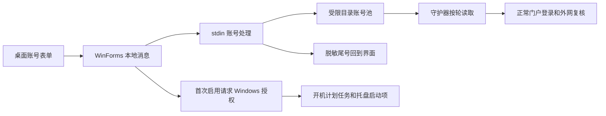

# 开发与验收

| 位置 | 职责 |
| --- | --- |
| `desktop/` | WinForms 窗口、托盘、单实例和本地 WebView2 资源 |
| `campus_maintenance.py` | 时段、网络判定、Wi-Fi 门禁与恢复 |
| `campus_status.py` / `campus_log.py` | 脱敏状态、轮转日志和暂停确认 |
| `campus_accounts.py` / `desktop/AccountService.cs` | 仅本地设置账号、显示尾号、衔接启动任务 |
| `enable_guardian.ps1` | 通过 Windows 授权安装并启动同一用户的 S4U 任务 |
| `browser_login.py` | 隔离 Edge 上的正常门户登录与外网复核 |
| `tests/` | 仅回环门户和部署产物的端到端演练 |

守护器按现有 Wi-Fi 和外网状态决定是否恢复。桌面账号表单通过 WebView2 的本地消息和子进程 stdin 保存，列表只回传尾号。首次设置调用 Windows 授权；任务确认启动后才安装托盘启动项，不要求先完成校园网认证。暂停仍由守护器执行并确认。



账号文件以明文保存在当前 Windows 用户、SYSTEM 和管理员可访问的受限目录，以便同一用户的 S4U 任务读取；禁止提交、上传或把运行目录打包。密码不经命令行参数、日志或状态快照。守护器每轮读取最新账号，提交前还检查该账号未被修改或删除。

```powershell
.\setup.ps1
.\build_desktop.ps1
.\demo.ps1 -SkipBuild
```

演练使用真实 EXE、WebView2 和本机回环门户，不触碰原有校园网。短流程覆盖首次填号、脱敏账号管理、换密码后守护器读取新值、联网状态、日志筛选与暂停拦截待发请求。测试模式不会登记真实 Windows 任务；S4U 和实际门户需在部署机单独验收。要验证守护器的时段与账号轮换，可单独运行：

```powershell
.\.venv\Scripts\python.exe -X utf8 tests/e2e_campus_maintenance.py --config config/campus.toml --portal tests/data/browser_journey.json --html tests/data/browser_portal.html --journey tests/data/campus_journey.json --output runtime/guardian-e2e.json
```

`demo.ps1` 默认演示可见的短流程。要额外验证暂停到期与守护重启：

```powershell
.\.venv\Scripts\python.exe -X utf8 tests/e2e_desktop.py --exe runtime/desktop/CampusGuardian.exe --output runtime/desktop-e2e
```

打包时先提交公开源码、重新构建，再运行 `python scripts/package.py --version 0.2.0`。输出 Windows ZIP 和 SHA-256；随包的 `licenses/` 记录 .NET 和 WebView2 SDK 的原始许可。

README 的媒体取自同一次回环演练。GIF 依次展示首次填号、模拟接入 SUSE、外网验证、保留其他 Wi‑Fi、账号管理和日志；Wi‑Fi 状态和门户均为模拟。PNG 来自实际桌面窗口，终端图取自真实演练输出。提交 issue 时仅附不含身份的结果代码与复现情况。

README 的呈现参考了 [Arcane](https://github.com/getarcaneapp/arcane#readme) 的首屏实物图、[uv](https://github.com/astral-sh/uv#readme) 的可复制命令与输出、[江山时序](https://github.com/DeanChensj/jiangshan-map/blob/main/README_ZH.md) 的短演示与真实使用场景。未复用这些项目的代码、图片或标识。
