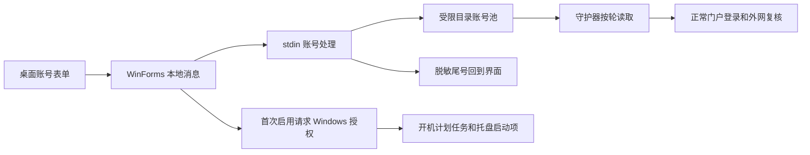
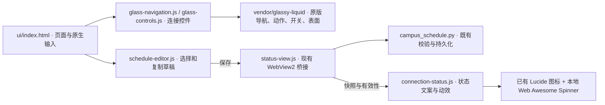
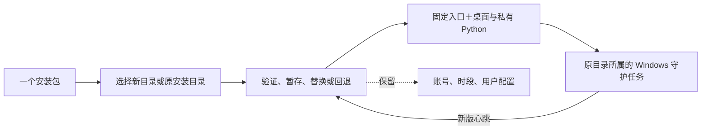

# 开发与验收

| 位置 | 职责 |
| --- | --- |
| `suse.cmd` | 用户入口；源码与发行包都调用 `app/scripts/suse.ps1` |
| `app/desktop/` | WinForms 窗口、托盘、单实例和本地 WebView2 资源 |
| `app/campus_maintenance.py` | 时段、网络判定、Wi-Fi 门禁与恢复 |
| `app/campus_schedule.py` | 周时段校验、旧配置读取和自定义设置持久化 |
| `app/campus_status.py` / `app/campus_log.py` | 脱敏状态、轮转日志和暂停确认 |
| `app/campus_accounts.py` / `app/desktop/AccountService.cs` | 仅本地设置账号、显示尾号、衔接启动任务 |
| `app/enable_guardian.ps1` | 通过 Windows 授权安装并启动同一用户的 S4U 任务 |
| `app/browser_login.py` | 隔离 Edge 上的正常门户登录与外网复核 |
| `app/network_diagnostics.ps1` | 认证遇到网络错误后的限时只读 DNS 对照，只回传结果布尔值 |
| `scripts/` | 开发者构建、打包和演练；不跟便携包发 |
| `tests/` | 仅回环门户和部署产物的端到端演练 |

守护器按现有 Wi-Fi 和外网状态决定是否恢复。桌面账号表单通过 WebView2 的本地消息和子进程 stdin 保存，列表只回传尾号。首次设置调用 Windows 授权；任务确认启动后才安装托盘启动项，不要求先完成校园网认证。暂停仍由守护器执行并确认。



账号文件以明文保存在当前 Windows 用户、SYSTEM 和管理员可访问的受限目录，以便同一用户的 S4U 任务读取；禁止提交、上传或把运行目录打包。密码不经命令行参数、日志或状态快照。守护器每轮读取最新账号，提交前还检查该账号未被修改或删除。

守护时段沿用已有 WebView2 本地消息和受限目录（与状态快照同目录的 `schedule.json`）。桌面校验后落盘；后台每轮读取，在 Wi-Fi 或认证动作前复核，心跳回传已读取的时段版本。新安装没有默认时段；仅无自定义文件时读取本机旧版 TOML 的 `schedule.windows`，自定义文件无效时仅观测，不回退到旧时段。

## 桌面界面

`app/desktop/ui/index.html` 承载状态、日志、首次设置和账号管理，由 `app/desktop/status-view.js` 接现有本地桥接。 `app/desktop/ui/style.css` 管理中性色、文字层级和实底分组，`schedule-editor.js` 只编辑日期、时间和复制草稿。 `glass-navigation.js` 与 `glass-controls.js` 把现有导航、按钮、开关接给原版玻璃控件，宿主事件仍沿用原动作。不改守护后台、数据格式、北京时间或跨日规则。

| 界面 | 参考与复用边界 |
| --- | --- |
| 状态页 | [Gentler Streak 的 iOS 设置](https://mobbin.com/screens/ca366da8-1c89-41cb-96c8-5805528dc313)；普通内容纵向分组，不给状态、操作和日志做独立玻璃卡片。 |
| 日志页 | [1Password](https://mobbin.com/screens/a5632ec1-f072-43e2-8f2b-ad047df4ca04)；筛选置顶，时间单列；沿用五种过滤。 |
| 首次设置 | [Amplitude](https://mobbin.com/screens/75c3b094-1130-49c3-9236-c13ee08cff8e)；居中单列表单，保留时段入口和单个主操作。 |
| 账号管理 | [Proton](https://mobbin.com/screens/1cbd9ced-59a6-4d30-b880-2514c9fe35a4)；账号逐行列出，添加动作放在列表下，只显示尾号。 |
| 守护时段 | [Lyssna](https://mobbin.com/screens/271e4e87-c20f-4738-bbf4-e856baa3ca6e)；左侧开关、中间时间下拉、右侧复制。只改变选中日期的草稿，可开启原来未设置的日期，保存后才写入。 |

以 [Apple 的内容层/控制层](https://developer.apple.com/design/human-interface-guidelines/materials) 为材质参考：中性实底承载正文、日志、表单；悬浮导航、主要操作按钮、时段开关和浮层直接使用 [glassy-liquid](https://github.com/9und30/glassy-liquid) 的 Web Components。源模块和 MIT 许可见 [UPSTREAM.md](../app/desktop/ui/vendor/glassy-liquid/UPSTREAM.md)，随程序本地加载；不引用 Apple 或 Mobbin 的图像。原生控件仍为加载失败时的回退。折射限于 WebView2 窗口内；高对比度和减少透明使用实底。

窗口标识沿用项目的 `campus-guardian.ico`；Wi‑Fi、显隐密码、复制等小图标来自 [Lucide 0.468.0](../app/desktop/ui/icons/lucide/UPSTREAM.md)。保留原版 SVG，随程序离线加载，不手绘路径。

状态区参考 [IHG 的 Wi‑Fi 检测](https://mobbin.com/screens/61e9df5c-4f3a-4dac-b84c-be35153e9691) 和 [NordVPN 的已连接状态](https://mobbin.com/screens/efe68d88-42bb-4d50-b002-15a052b95f3d)，使用已有 Lucide Wi‑Fi 图标和单独打包的 [Web Awesome Spinner](../app/desktop/ui/vendor/webawesome/UPSTREAM.md)。`connection-status.js` 只把后台已报告的接入、检查、验证、外网结果并排显示；不驱动后台，不伪造检测进度。正在处理时才转圈，恢复在线时只亮一次，启用减少动态效果后保留同样的文字但不播放动画。



从仓库根目录运行下列命令；构建需要 [.NET 10 SDK](https://dotnet.microsoft.com/en-us/download/dotnet/10.0)。源码运行环境与桌面产物在 `app/`，SDK 缓存、测试报告和候选 ZIP 在根目录的 `runtime/`，均不提交。

```powershell
.\app\setup.ps1
.\scripts\build_desktop.ps1
.\scripts\demo.ps1 -SkipBuild
```

演练使用真实 EXE、WebView2 和本机回环门户，不触碰原有校园网。短流程覆盖首次选择并复制守护时段、跨日及重叠校验、在线修改时段并停止待提交的登录，以及账号管理、恢复、日志与暂停。测试模式不会登记真实 Windows 任务；S4U 和实际门户需在部署机单独验收。要验证保留的旧时段与账号轮换，可单独运行：

```powershell
.\app\.venv\Scripts\python.exe -X utf8 tests/e2e_campus_maintenance.py --config app/config/campus.toml --portal tests/data/browser_journey.json --html tests/data/browser_portal.html --journey tests/data/campus_journey.json --output runtime/guardian-e2e.json
```

`scripts/demo.ps1` 默认演示可见的短流程。要额外验证暂停到期与守护重启：

```powershell
.\app\.venv\Scripts\python.exe -X utf8 tests/e2e_desktop.py --exe app/runtime/desktop/CampusGuardian.exe --output runtime/desktop-e2e
```

打包前先提交公开源码、重新构建，再运行 `python scripts/package.py --version 0.3.0`。ZIP 按运行文件清单生成，第三方许可在 `app/licenses/`。测试、演练与开发脚本只留源码，不随包发；发布方应从实际解压包验证入口，而不是让下载者跑测试。仅验收当前布局时，可附 `--output-dir runtime/layout-verification`，不覆盖现有发行文件。

```powershell
.\app\.venv\Scripts\python.exe -X utf8 tests/e2e_installation.py --zip runtime/release/CampusNetworkGuardian-0.3.0-win-x64.zip --legacy runtime/release/CampusNetworkGuardian-0.2.5-win-x64.zip --output runtime/distribution-e2e
```

`docs/media/` 只保留 README 用到的 GIF 和图标；逐帧截图与演练报告留在本机 `runtime/`，不提交。`scripts/render_demo.py` 从回环演练的真实窗口截图生成 GIF；Wi‑Fi 状态和门户均为模拟。提交 issue 时仅附不含身份的结果代码与复现情况。

## 0.3.0 安装和升级流程

- `scripts/package_runtime.py` 与 `scripts/runtime-win-x64.json` 从固定上游归档组装运行时，发布只上传一个 Windows ZIP。校验摘要仍由打包和发布端使用，不让使用者单独处理。
- `app/scripts/deploy.ps1` 负责安装、替换、回退；`setup.ps1` 优先使用 `app/runtime/python`。对源码开发保留原来的 venv 准备方式。启用后的托盘和计划任务始终回到首次选择的路径。
- **可替换**：清单里的脚本、桌面程序和私有 Python。**原地保留**：账号、时段、用户配置、浏览器资料和观测数据。任务启动失败回退程序和任务动作；遇到其他目录的任务不接管。中途断电后保留事务区，不猜测可删数据。



README 的呈现参考了 [Arcane](https://github.com/getarcaneapp/arcane#readme) 的首屏实物图、[uv](https://github.com/astral-sh/uv#readme) 的可复制命令与输出、[江山时序](https://github.com/DeanChensj/jiangshan-map/blob/main/README_ZH.md) 的短演示与真实使用场景。未复用这些项目的代码、图片或标识。

## 停用与卸载

在现有安装目录操作。用管理员 PowerShell 运行运行目录里的 `install_campus_maintenance.ps1 -Mode Uninstall -Logon S4U`，再以同一 Windows 用户运行 `install_desktop.ps1 -Mode Uninstall`，从托盘退出。发行包内两份脚本在 `app/`；旧版在解压根目录。不要从另一个安装目录卸载。停用不会删除账号或主动下线。
